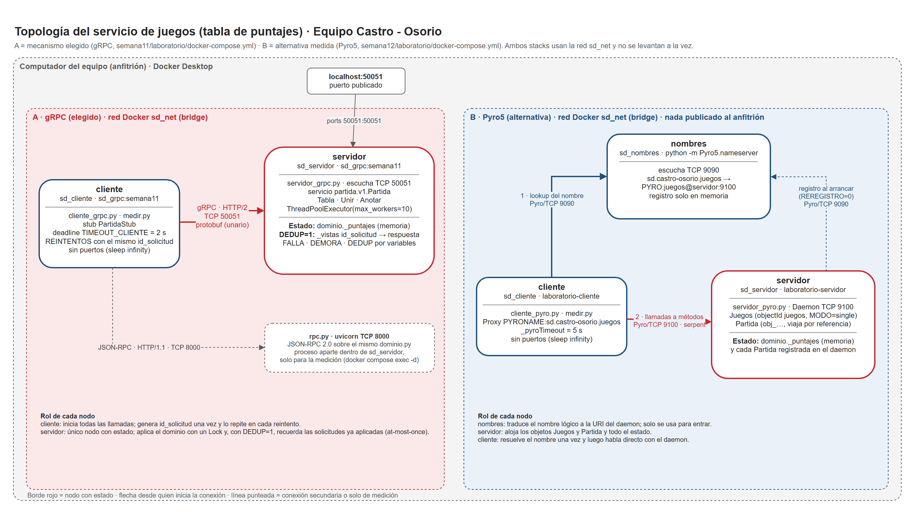

# Reporte de Servicios Cliente-Servidor

**Equipo** Castro - Osorio
**Integrantes** Felipe Castro, David Osorio
**Dominio** Juegos, tabla de puntajes
**Repositorio** https://github.com/Pewiz/sd-castro-osorio
**Fecha** 20-11-2026

## 1. El servicio y su dominio

El servicio guarda la **tabla de puntajes de una partida multijugador**. Lo usan los clientes del juego (uno por jugador) y cualquier pantalla que muestre el marcador. El problema que resuelve es tener un solo lugar donde vive el puntaje, de modo que todos vean el mismo número aunque varios jugadores anoten al mismo tiempo. Ese problema ya apareció en la semana 6: sin `Lock`, 20 clientes que enviaron 50 veces `ANOTAR felipe 1` cada uno dejaron a felipe con 106 puntos en vez de 1000 (`semana06/laboratorio/observaciones.md`, paso 3).

Las reglas del negocio viven en `dominio.py` (`semana11/laboratorio/dominio.py`, copiado igual en `semana12/laboratorio/`). Ese archivo no sabe nada de red y es lo que no cambió cuando cambiamos de mecanismo.

| Operación | Qué hace | Cambia estado | Idempotente | Errores del dominio |
|---|---|---|---|---|
| `tabla()` | Devuelve `{jugador: puntos}` de todos los jugadores | No | Sí | Ninguno |
| `unir(jugador)` | Agrega un jugador con 0 puntos | Sí | No (la 2.ª vez falla con "ya existe") | `ErrorParametros` (nombre vacío o con espacio), `ErrorDominio` (ya existe) |
| `anotar(jugador, puntos)` | Suma `puntos` al jugador y devuelve el total | Sí | **No, suma cada vez** | `ErrorParametros` (puntos menores o iguales a 0), `ErrorDominio` (no existe) |

En la semana 12 agregamos, solo para Pyro5, el objeto `Partida` (`semana12/laboratorio/objetos.py`): acumula los puntos de una partida en curso y los aplica a la tabla con `finalizar()`.

El estado (`_puntajes`) es un diccionario en la memoria del proceso servidor, protegido con un `threading.Lock`. Parte con `{"david": 0, "felipe": 0}`. **No hay persistencia**, y eso pesa en la sección 6.

## 2. Arquitectura y topología



*Figura 1. Topología del servicio (`docs/informe/img/topologia.png`). A la izquierda el despliegue del mecanismo elegido (`semana11/laboratorio/docker-compose.yml`) y a la derecha la alternativa con Pyro5 (`semana12/laboratorio/docker-compose.yml`).*

Los dos despliegues usan una red Docker tipo *bridge* llamada `sd_net` y nombres de contenedor fijos (`sd_servidor`, `sd_cliente`). Por eso se levantan uno a la vez. Los clientes encuentran al servidor por su nombre de servicio (`servidor`), que resuelve el DNS interno de Docker.

**A. gRPC (elegido).** Dos nodos con la misma imagen `sd_grpc:semana11` (`grpcio==1.80.0`).

| Nodo | Rol | Puertos y protocolo |
|---|---|---|
| `servidor` (`sd_servidor`) | Único nodo con estado. `servidor_grpc.py` expone el servicio `partida.v1.Partida` (`Tabla`, `Unir`, `Anotar`) con un `ThreadPoolExecutor` de 10 hilos. Con `DEDUP=1` guarda en `_vistas` la respuesta de cada `id_solicitud`. Las variables `FALLA`, `DEMORA` y `DEDUP` permiten provocar fallas sin tocar código | Escucha TCP 50051, gRPC sobre HTTP/2 con Protocol Buffers. Se publica `50051:50051` al anfitrión |
| `cliente` (`sd_cliente`) | Inicia todas las llamadas. `cliente_grpc.py` usa el stub `PartidaStub`, aplica un *deadline* (`TIMEOUT_CLIENTE`, 2 s) y reintenta `REINTENTOS` veces con el **mismo** `id_solicitud` | No publica puertos (`sleep infinity`) |

Para la medición de la sección 5 levantamos también `rpc.py` (JSON-RPC 2.0 sobre FastAPI, puerto 8000) como un segundo proceso dentro de `sd_servidor`, con `docker compose exec -d`. Usa el mismo `dominio.py`, pero tiene su propia copia del estado en memoria. En la figura aparece con línea punteada porque no es parte del compose.

**B. Pyro5 (alternativa).** Tres nodos, nada publicado al anfitrión.

| Nodo | Rol | Puertos y protocolo |
|---|---|---|
| `nombres` (`sd_nombres`) | Servidor de nombres de Pyro5. Traduce `sd.castro-osorio.juegos` a `PYRO:juegos@servidor:9100`. Solo se usa para entrar, y su registro vive en memoria | TCP 9090 |
| `servidor` (`sd_servidor`) | Daemon de Pyro5 (`servidor_pyro.py`) con el objeto `Juegos` (id fijo `juegos`, `MODO=single`) y los objetos `Partida` que crea `abrir_partida()`. Guarda la tabla y las partidas abiertas. Se registra en `nombres` al arrancar (`REREGISTRO=0`) | TCP 9100, protocolo Pyro con serializador `serpent` |
| `cliente` (`sd_cliente`) | Crea un `Proxy("PYRONAME:...")`, resuelve el nombre una vez y después habla directo con el daemon | Sin puertos |

## 3. Evolución del contrato

Seguimos la misma operación, **anotar 15 puntos a felipe**, porque es la que más cambia: es la que modifica estado y la que no se puede repetir sin consecuencias.

| Etapa | Semana | Dónde está el contrato | Ejemplo de la misma operación |
|---|---|---|---|
| Protocolo de texto sobre TCP | 4 y 6 | `semana04/protocolo.md`, `semana06/laboratorio/protocolo.md` | Semana 4: la operación todavía no existía, solo `HOLA`, `ECO`, `CONTAR` y `SALIR` (`semana04/servidor/servidor.py`). Semana 6: `ANOTAR felipe 15\n`, que responde `OK felipe 15\n` |
| REST | 7 | `semana07/laboratorio/protocolo.md` (sección 9.2), `api.py` | `POST /jugadores/felipe/puntos` con `{"puntos": 15}`, que responde `201 {"jugador":"felipe","puntos":15,"replica":"api2"}` |
| Mensajes estructurados | 9 | `semana09/laboratorio/protocolo.md` v3, `mensajes.py` | 4 bytes de largo + `{"operacion":"ANOTAR","argumentos":["felipe","15"],"id":7,"version":2}`, que responde `{"id":7,"estado":"OK","datos":["felipe","15"],"error":""}` (78 B; en codec `bin`, 26 B) |
| JSON-RPC | 10 | `semana10/rpc.py`, `semana10/pruebas.md` | `{"jsonrpc":"2.0","method":"anotar","params":{"jugador":"felipe","puntos":15},"id":1}`, que responde `{"jsonrpc":"2.0","result":{"jugador":"felipe","puntos":15},"id":1}` |
| gRPC | 11 | `semana11/laboratorio/proto/servicio.proto` | `stub.Anotar(AnotarSolicitud(id_solicitud=uuid4().hex[:8], jugador="felipe", puntos=15), timeout=2)`, que devuelve `JugadorRespuesta(jugador="felipe", puntos=15)` |
| Objetos remotos | 12 | `semana12/laboratorio/objetos.py` | `juegos.anotar("felipe", 15)`, o con estado: `p = juegos.abrir_partida("felipe"); p.sumar(15); p.finalizar()` |

**¿Qué ganamos y qué perdimos en cada cambio?**

**Texto TCP (de la semana 4 a la 6).** En la semana 4 el servidor atendía un cliente a la vez: un segundo cliente se conectaba, pero recibía `TIMEOUT` a los 5 s (`semana04/observaciones.md`). En la 6 *ganamos* concurrencia (hilo por cliente: 5 clientes con `ESPERA 2` pasaron de 10,02 s a 2,02 s), estado compartido con `Lock`, y errores con código (`ERROR JUGADOR_NO_EXISTE`). *Perdimos* poco, pero el contrato tenía límites claros: un mensaje es una línea, así que un nombre con espacio o salto de línea podía inyectar otro comando, y la respuesta no traía nada que la emparejara con la solicitud.

**De texto a REST (7).** *Ganamos* un formato estándar (HTTP + JSON), códigos con significado común (404, 409, 422, 503, 504), documentación automática en `/docs`, validación de entrada antes de llegar al servidor (`^[a-z0-9_]{1,30}$`, puntos > 0) y la posibilidad de replicar el nivel sin estado (`api1`, `api2` detrás de Nginx). *Perdimos* simplicidad: hay un salto más (de la API al servidor TCP) y dos fallas nuevas que el cliente tiene que distinguir (503 sin servidor y 504 servidor lento). Además, "anotar puntos" no encaja bien como recurso. Terminó siendo un `POST`, que HTTP define como no idempotente, sin ninguna clave para reconocer un reintento.

**De REST a mensajes estructurados (9).** Volvimos a TCP, pero con un mensaje de verdad. *Ganamos* enmarcado por largo (se acabó el problema del salto de línea), un campo `version` (el servidor rechaza la 1 sin cortar la conexión), un `id` para emparejar respuestas y dos codecs intercambiables. El binario ocupa 73 % menos en la solicitud y 51 % menos en la respuesta (`semana09/laboratorio/protocolo.md`, sección 7). *Perdimos* el estándar: todo el protocolo era nuestro, lo documentamos a mano y cliente y servidor tenían que coincidir en el codec. Con codecs cruzados el servidor solo podía responder `mensaje mal formado`.

**De mensajes propios a JSON-RPC (10).** *Ganamos* que una especificación pública decidiera por nosotros los nombres de los campos (`jsonrpc`, `method`, `params`, `id`), los códigos de error (de -32700 a -32600 para el protocolo y -32000 para el dominio) y hasta lotes y notificaciones (`semana10/pruebas.md`, casos 1 a 9). *Perdimos* el formato compacto y no ganamos un contrato legible por una máquina. Las operaciones siguen escritas solo en la documentación, y un tipo mal puesto (`"abc"` como puntos) recién se detecta al ejecutar. Además, una notificación se ejecuta sin que el cliente sepa si funcionó: el caso 8 agregó a `pedro` y respondió 204 sin cuerpo.

**De JSON-RPC a gRPC (11).** *Ganamos* un IDL. `servicio.proto` define tipos, operaciones y números de campo, y desde él se generan los stubs (`generar.sh` produce `servicio_pb2.py` y `servicio_pb2_grpc.py`). El contrato puede crecer con números de campo nuevos sin romper clientes antiguos. *Ganamos* también códigos de estado estándar (`INVALID_ARGUMENT`, `FAILED_PRECONDITION`, `UNAVAILABLE`, `DEADLINE_EXCEEDED`, `UNIMPLEMENTED`; ver la tabla de la sección 3 de `semana11/laboratorio/observaciones.md`), *deadlines* en cada llamada y, lo más importante, que **`id_solicitud` quedó dentro del contrato** de `Unir` y `Anotar`. *Perdimos* legibilidad: ya no se puede probar con `curl` (para provocar `UNIMPLEMENTED` tuvimos que armar una llamada con `unary_unary` a mano). También sumamos un paso de generación de código, y un navegador no habla gRPC sin un proxy.

**De gRPC a objetos remotos (12).** *Ganamos* objetos con identidad y estado. `Partida` vive en el servidor y el cliente solo tiene un `Proxy` (`PYRO:obj_...@servidor:9100`). También ganamos transparencia de ubicación con el servidor de nombres y excepciones del dominio que llegan con su tipo (`register_dict_to_class`). *Perdimos* el contrato independiente del lenguaje, porque la interfaz es una clase Python y Pyro5 solo existe para Python. *Perdimos* también el `id_solicitud`, y aparecieron problemas nuevos: referencias colgantes (`unknown object` al usar una partida ya finalizada), objetos que nadie libera porque Pyro5 no tiene recolector de basura distribuido (`partidas_vivas()`) y objetos que no pueden viajar por valor (con `POR_VALOR=1` el cliente recibió `unsupported serialized class: objetos.Partida`).

En resumen, cada etapa trasladó una decisión del equipo a la herramienta: primero el enmarcado (9), después el formato de error (10), después los tipos y el contrato (11) y al final la identidad del objeto (12). La única decisión que la herramienta no tomó por nosotros en ninguna etapa fue cómo reconocer un reintento. La agregamos a mano en el `.proto`.

## 4. Mecanismo elegido y justificación

Para la presentación del 4-12 nos quedamos con **gRPC**. Lo comparamos con **Pyro5** (la alternativa más rápida que medimos y la que usamos en la semana 12) y con **JSON-RPC 2.0** (la que el cuadro de la semana 10 recomendaba para servicios internos). Los criterios son los del cuadro (`semana10/cuadro_comparativo.md`), más los dos que medimos nosotros: latencia y comportamiento ante fallas. Antes de la tabla fijamos qué necesita **nuestro** dominio:

- **N1. Anotar como máximo una vez.** `anotar` suma. Si un reintento se aplica dos veces, la tabla muestra puntos que nadie ganó y, en una competencia, un ganador equivocado. Lo vimos: 25 puntos terminaron en 75 (semana 11, caso 3).
- **N2. Consultar el marcador seguido y sin riesgo.** `tabla` es la operación más frecuente (`vigilar` la llama cada 1 s), y como es idempotente se puede reintentar libremente.
- **N3. Clientes heterogéneos.** Los clientes de un juego rara vez están escritos en Python (motores en C#, C++ o JavaScript). El contrato tiene que poder compilarse en otros lenguajes.
- **N4. Errores que el cliente pueda distinguir**: "el jugador no existe" pide corregir el dato, "servidor lento" pide esperar y reintentar.
- **N5. Que el contrato crezca** (por ejemplo, agregar `Ranking` o `Abandonar`) sin romper clientes que ya están instalados.

| Criterio (cuadro sem. 10 y dominio) | **gRPC (elegido)** | Pyro5, objetos remotos | JSON-RPC 2.0 |
|---|---|---|---|
| Modelo | Procedimientos remotos sin estado de sesión. La partida en curso la lleva el cliente | Objetos remotos con estado (`Partida`) y referencias | Procedimientos remotos, cada llamada independiente |
| Contrato / IDL (N3, N5) | `servicio.proto`, independiente del lenguaje y versionado por número de campo | Clase Python en `objetos.py`, sin IDL | Sin IDL. Contrato en documentación (`pruebas.md`) |
| Transporte y formato | HTTP/2, Protocol Buffers binario. `tabla` = **19 B** | TCP propio, `serpent` (texto tipo Python). `tabla` = **48 B** | HTTP/1.1, JSON. `tabla` = **56 B** de cuerpo |
| Lenguajes (N3) | Stubs oficiales para C#, C++, Java, Go, JS/Node, Python y otros | Solo Python | Cualquiera que lea JSON, pero cada cliente escribe su propio stub |
| Estado y referencias | El servidor no recuerda al cliente, solo los `id_solicitud` ya aplicados | Sí, y con los problemas que vimos: referencias colgantes, sin recolector de basura distribuido | No |
| Errores (N4) | Códigos de estado estándar. Distingue dominio (`FAILED_PRECONDITION`), parámetros, caída y lentitud | Excepción remota con su tipo. Caída y lentitud llegan como `CommunicationError` / `TimeoutError` | Objeto `error` con `code`. La lentitud depende del timeout HTTP del cliente |
| Reintento seguro (N1) | **`id_solicitud` obligatorio en el contrato** y, con `DEDUP=1`, *at-most-once* observado | No hay clave de solicitud. Reintentar `anotar` puede duplicar | `id` existe, pero sirve para emparejar la respuesta, no para deduplicar |
| Plazo por llamada (N2, N4) | *Deadline* nativo (`timeout=`) que viaja al servidor | `_pyroTimeout` en el proxy, solo del lado del cliente | Timeout del cliente HTTP |
| Latencia medida de `tabla` (N2) | p50 entre 1,0 y 1,18 ms; p95 entre 1,24 y 1,89 ms | **p50 entre 0,30 y 0,63 ms**; p95 entre 0,39 y 0,83 ms | p50 entre 1,56 y 1,89 ms; p95 entre 2,0 y 2,89 ms |
| Estado actual (cuadro sem. 10) | Vigente y muy usado entre servicios | Vigente, nicho Python | Vigente (Ethereum, LSP) |

**Por qué gRPC y no Pyro5.** Pyro5 gana en latencia y modela de forma elegante la "partida en curso" como objeto. Pero falla en las dos necesidades que más pesan en un juego. Primero, N3: un cliente de juego en C# no puede usar Pyro5. Segundo, N1: no hay forma de reconocer un reintento, y su ventaja de diseño, el objeto `Partida` con estado en el servidor, fue justamente lo que más perdimos en la falla de la semana 12. La partida de david quedó como referencia colgante y sus 5 puntos nunca llegaron a la tabla. Con gRPC la partida en curso la acumula el cliente, y se envía un solo `Anotar` con `id_solicitud`, que el servidor reconoce si llega repetido.

**Por qué gRPC y no JSON-RPC.** JSON-RPC es más fácil de probar (`curl`) y tan portable como gRPC. Pero no tiene IDL (N3 y N5 quedan a mano en cada lenguaje), su `id` no sirve para deduplicar (N1), las notificaciones ejecutan cambios sin confirmación (caso 8 de `pruebas.md`) y además fue el más lento en la medición.

**Lo que aceptamos al elegir gRPC.** Es menos legible para depurar, necesita generar código cada vez que cambia el `.proto` y no corre directo en el navegador. Para un marcador web habría que poner un proxy gRPC-Web o una puerta REST como la de la semana 7.

## 5. Evidencia de funcionamiento y medición

El servicio funciona entre contenedores distintos. Las salidas completas están en `docs/informe/evidencia/ejecucion_20-11-2026.md`.

```text
# semana11/laboratorio, gRPC
$ docker compose ps
sd_cliente    sd_grpc:semana11   "sleep infinity"         cliente    Up
sd_servidor   sd_grpc:semana11   "python servidor_grp..."   servidor   Up   0.0.0.0:50051->50051/tcp
$ docker compose exec cliente python cliente_grpc.py unir ana
[cliente] intento 1, id_solicitud=c255ebcc, deadline 2 s
[cliente]   OK ana puntos=0
$ docker compose exec cliente python cliente_grpc.py anotar ana 15
[cliente] intento 1, id_solicitud=06ef2967, deadline 2 s
[cliente]   OK ana puntos=15
$ docker compose exec cliente python cliente_grpc.py tabla
[cliente]   ana=15, david=0, felipe=0
cliente 172.19.0.3  ->  servidor 172.19.0.2:50051

# semana12/laboratorio, Pyro5
$ docker compose exec cliente python cliente_pyro.py uri
15:40:47 sd.castro-osorio.juegos -> PYRO:juegos@servidor:9100
$ docker compose exec cliente python cliente_pyro.py partida david 5
15:40:48 recibí Proxy, referencia PYRO:obj_0f61f4e96ba544b5b0f8dbb13ae8992d@servidor:9100
15:40:48 finalizar -> {'jugador': 'david', 'puntos': 5}
cliente 172.19.0.4  ->  nombres 172.19.0.2:9090, servidor 172.19.0.3:9100
```

**Medición con `medir.py`.** Usamos la operación de consulta `tabla`, la misma en los tres mecanismos, con n = 200 llamadas medidas (más 10 de calentamiento) y la tabla en su estado inicial (`david=0, felipe=0`), reiniciando el servidor antes para que la respuesta fuera idéntica. Ejecutamos cada mecanismo tres veces. Abajo va la primera corrida de cada uno, tal como la imprimió `medir.py`. Las nueve filas están en `semana11/laboratorio/mediciones.csv` y `semana12/laboratorio/mediciones.csv`.

| Mecanismo | Operación | n | p50 ms | p95 ms | media ms | máx ms | respuesta bytes |
|---|---|---|---|---|---|---|---|
| grpc (elegido) | tabla | 200 | 1.18 | 1.89 | 1.28 | 3.1 | 19 |
| pyro | tabla | 200 | 0.63 | 0.83 | 0.64 | 2.78 | 48 |
| jsonrpc | tabla | 200 | 1.88 | 2.89 | 1.98 | 4.77 | 56 |

Repeticiones (p50 en ms): gRPC 1,00 y 1,03; Pyro5 0,34 y 0,30; JSON-RPC 1,56 y 1,89. El orden se mantuvo en las tres corridas: **primero Pyro5, después gRPC y al final JSON-RPC**. Pyro5 bajó de 0,63 a cerca de 0,3 ms después de la primera corrida, y lo atribuimos a que el servidor y el proceso Python todavía se estaban calentando (el contenedor recién se había reiniciado).

**¿Qué explica la diferencia?** Todos corren en el mismo notebook y la misma red `sd_net`, con el mismo `dominio.tabla()` detrás, así que la diferencia la pone la pila de comunicación:

- **Pyro5 es el más liviano por llamada.** El proxy abre **una** conexión TCP en la primera llamada (después de preguntarle a `nombres`) y la reutiliza. Cada llamada es un encabezado corto de Pyro + un mensaje `serpent`, y el daemon la despacha directo al método. No hay HTTP en medio.
- **gRPC paga HTTP/2.** También reutiliza una sola conexión (el `channel`), pero cada llamada abre un *stream* nuevo con marcos `HEADERS` (comprimidos con HPACK) y `DATA`, pasa por el núcleo en C de `grpcio` y se entrega a un hilo del `ThreadPoolExecutor`. Ese cambio de hilo y el empaquetado HTTP/2 explican cerca de 0,7 ms más que Pyro5 en Python. A cambio, su respuesta es la más chica (**19 B**), porque Protocol Buffers manda números de campo y enteros *varint* en vez de nombres.
- **JSON-RPC es el más lento porque el adaptador de `medir.py` (`urllib.request`) abre una conexión TCP nueva en cada llamada**: *handshake*, petición HTTP/1.1 con encabezados de texto, FastAPI/uvicorn y `json.loads`. Su cuerpo (56 B) es además el más grande, porque repite `"jsonrpc"`, `"result"` e `"id"` en cada respuesta.
- Los bytes que informa `medir.py` son solo la carga útil. No cuentan los encabezados HTTP ni los marcos HTTP/2, así que en la red la diferencia entre gRPC y JSON-RPC es mayor de lo que muestra la tabla.

**¿Importa esa diferencia para nuestro dominio?** **No.** Un marcador se refresca a escala humana. `vigilar` consulta cada 1 s y el *deadline* del cliente es de 2 s, así que pasar de 0,3 a 1,2 ms es menos del 0,1 % del intervalo de refresco. Mirando el p95, ninguno pasó de 3 ms. La latencia empezaría a importar con cientos de jugadores consultando a la vez, y aun ahí convendría primero no consultar tan seguido (por ejemplo, que el servidor empuje los cambios con un *streaming* de gRPC) antes que cambiar de mecanismo. Lo que sí importa en el dominio es lo que muestra la sección siguiente: que un punto no se pierda ni se cuente dos veces.

## 6. Análisis de fallos

Según la teoría (Tanenbaum y Van Steen, 2017, sección 8.3; Coulouris et al., 2001, cap. 5), cuando un cliente no recibe respuesta no puede saber si el servidor cayó **antes** o **después** de ejecutar. Lo que haga entonces define la semántica. Si no reintenta, la operación se aplicó 0 o 1 vez y el cliente no sabe cuál (*maybe*). Si reintenta sin que el servidor filtre duplicados, se aplica 1 o más veces (*at-least-once*). Si reintenta con un identificador y el servidor guarda lo ya respondido, se aplica 0 o 1 vez (*at-most-once*). Y si el servidor pierde la memoria al caer, pierde también la lista de duplicados.

| Falla provocada | Qué esperaban según la teoría | Qué observaron | Qué harían para tolerarla |
|---|---|---|---|
| **Servidor cae a mitad de una llamada** (semana 11, gRPC, casos 2 a 5) | Sin reintentos: *maybe*, el cliente no sabe si se aplicó. Con reintentos sin deduplicación: *at-least-once*, `Anotar` se duplica. Con `id_solicitud` y `DEDUP`: *at-most-once*. Si el proceso muere, se pierde el estado en memoria | Caso 2: `DEADLINE_EXCEEDED`, el cliente informa "estado DESCONOCIDO", pero la tabla mostró 25, o sea que **sí se aplicó**. Caso 3 (2 reintentos, sin `DEDUP`): 3 errores en el cliente y **75 puntos** en la tabla, el log muestra tres `Anotar id=4ba56b26`. Caso 4 (`DEDUP=1`): el segundo intento devolvió `OK puntos=25` y el log dice `repetido, devuelvo lo guardado SIN aplicar de nuevo`. Caso 5 (`kill`): `UNAVAILABLE, Socket closed` y, al volver, la tabla en 0 | Correr siempre con `DEDUP=1` y `REINTENTOS` en 1 o más, que ya están implementados y solo requieren configuración. Para que *at-most-once* sobreviva a la caída, guardar `_puntajes` y `_vistas` juntos en almacenamiento estable (archivo o SQLite), en la misma escritura |
| **Servidor cae y vuelve** (semana 12, Pyro5, tiempos 1 y 2) | El proxy puede reconectarse porque `Juegos` tiene puerto (9100) e id (`juegos`) fijos, pero los objetos creados en caliente (`Partida`, id aleatorio) no existen en el proceso nuevo: sus referencias quedan colgantes. Todo lo que estaba en memoria se pierde | `vigilar` mostró `ConnectionClosedError`, después `reconectado`, y la tabla volvió **sin `ana` ni sus 10 puntos**. La partida reintentó `finalizar()` con la misma URI y recibió `unknown object`: los 5 puntos de david nunca llegaron. Un cliente nuevo vio `partidas vivas 0` | Persistir la tabla. No dejar estado del jugador en objetos de sesión del servidor: que el cliente acumule la partida y la envíe en un solo `Anotar` con `id_solicitud`, que es justo el diseño del mecanismo elegido |
| **Servidor de nombres cae** (semana 12, Pyro5, tiempo 3) | Los clientes que ya resolvieron la URI siguen funcionando, porque `nombres` solo participa al entrar. Los clientes nuevos no pueden entrar. Al volver, un servidor de nombres sin almacenamiento persistente queda vacío | `vigilar` siguió en `ok` todo el tiempo (`felipe 7`). Un cliente nuevo vio `Failed to locate the nameserver` y, con `nombres` de vuelta, `unknown name: sd.castro-osorio.juegos`, hasta que reiniciamos el servidor (y ahí se perdió la tabla). Con `REREGISTRO=5`, un cliente nuevo respondió a los pocos segundos sin perder estado | `REREGISTRO` activado, o un servidor de nombres con almacenamiento persistente (opción `-s sql:archivo`). En gRPC el equivalente es el DNS de Docker: con el servidor detenido vimos `UNAVAILABLE, ... Domain name not found` (`semana11/laboratorio/observaciones.md`, sección 3) |

Extractos de los registros que respaldan la tabla (completos en `semana11/laboratorio/observaciones.md`, sección 4, y en `semana12/laboratorio/observaciones.md` paso 5):

```text
# semana 11, caso 3 (reintentos sin DEDUP): un mismo id_solicitud aplicado tres veces
[servidor] Anotar id=4ba56b26 -> {'jugador': 'felipe', 'puntos': 25}
[servidor] Anotar id=4ba56b26 -> {'jugador': 'felipe', 'puntos': 50}
[servidor] Anotar id=4ba56b26 -> {'jugador': 'felipe', 'puntos': 75}
# semana 11, caso 4 (DEDUP=1): el reintento se reconoce y no se aplica
[servidor] Anotar id=c77c5d9e -> {'jugador': 'felipe', 'puntos': 25}
[servidor] Anotar id=c77c5d9e repetido, devuelvo lo guardado SIN aplicar de nuevo
# semana 12, tiempo 2 (Pyro5): la partida no sobrevive al reinicio del servidor
20:47:09 se cortó la conexión (ConnectionClosedError). Reintento con la MISMA referencia durante 30 s
20:47:13 ERROR. El servidor responde, pero el objeto de esa referencia ya no existe (referencia colgante)
20:47:14 ok, tabla {'david': 0, 'felipe': 0}      <- ana y sus 10 puntos ya no están
```

Las tres fallas coincidieron con la teoría en lo que importa. La diferencia más interesante fue en la primera: esperábamos que el cliente viera un error y la tabla quedara igual, y en realidad el cliente vio un error **y la tabla cambió**. El error del cliente no dice nada sobre lo que pasó en el servidor. Hubo también una sorpresa menor: con el servidor gRPC detenido y el *deadline* de 2 s, el cliente vio `DEADLINE_EXCEEDED` y no `UNAVAILABLE`, porque resolver un nombre que ya no existe en el DNS de Docker tomó más de 2 s. "Caído" y "lento" se confunden, igual que el `TIMEOUT` de la semana 4.

**¿Qué semántica ofrece hoy el servicio?** Depende de la configuración, y eso está en `semana11/laboratorio/docker-compose.yml`:

- **Por defecto** (`DEDUP=0`, `REINTENTOS=0`): *maybe*. El cliente no reintenta y, si se vence el plazo, no sabe si se anotó (caso 2).
- **Con reintentos y sin `DEDUP`**: *at-least-once*. Es correcto para `Tabla`, pero peligroso para `Anotar` (caso 3).
- **Con `DEDUP=1` y reintentos**: *at-most-once* mientras el proceso servidor siga vivo (caso 4). No sobrevive a una caída, porque `_vistas` y `_puntajes` están en memoria (caso 5).
- **En Pyro5**: *maybe*, sin clave de solicitud. Además, el estado de `Partida` muere con el servidor.

**¿Cuál necesita el dominio?** Para `Tabla`, *at-least-once* basta, porque reintentar una consulta no cambia nada. Para `Anotar` y `Unir`, el jugador espera **exactamente una vez**: ni puntos perdidos ni duplicados. En la práctica eso se logra combinando reintentos del cliente (*at-least-once*) con deduplicación por `id_solicitud` en el servidor (*at-most-once*), con el estado y la tabla de duplicados en **almacenamiento estable**. Para el 4-12 presentaremos gRPC con `DEDUP=1` y `--reintentos 2`, que ya probamos. La persistencia es lo que nos falta para que la garantía sobreviva a una caída del servidor, y queda como siguiente paso.

**Cierre.** La medición y las fallas apuntan a lo mismo. Ninguno de los tres mecanismos es lento para un marcador, pero solo uno lleva en su contrato lo que el dominio necesita para no contar mal los puntos. Elegimos gRPC por el `id_solicitud` de `servicio.proto`, por los códigos de estado que distinguen "jugador inexistente" de "servidor lento" y porque el contrato se puede compilar para un cliente de juego que no esté escrito en Python. Lo que aprendimos de Pyro5 (que el estado de una partida no debe vivir en un objeto de sesión del servidor) y de las tres fallas (que hay que persistir la tabla junto con los ids ya aplicados) es lo que vamos a mejorar sobre esa base.

## 7. Referencias

1. Tanenbaum, A. S. y Van Steen, M. (2017). *Distributed Systems* (3.ª ed.). Cap. 4, sección 4.2 "Remote procedure call", y cap. 8, sección 8.3 "Reliable client-server communication" (semánticas ante fallas). Bibliografía del curso.
2. Coulouris, G., Dollimore, J. y Kindberg, T. (2001). *Sistemas Distribuidos. Conceptos y diseño* (3.ª ed.). Cap. 5, "Objetos distribuidos e invocación remota" (semánticas de invocación, RMI). Bibliografía del curso.
