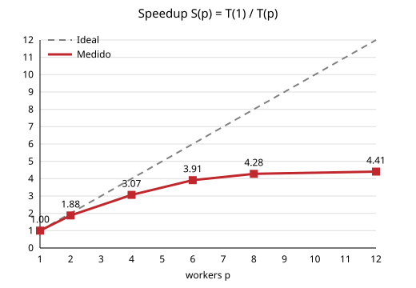

# Análisis de speedup, trabajo autónomo semana 13

Equipo castro-osorio
Integrantes Felipe Castro, David Osorio
Fecha 27-11-2026

Pregunta: ¿por qué el master-worker del taller no es 4 veces más rápido con 4 workers?

## Datos de partida (taller)

Entorno: Docker Desktop con **12 CPU**, en un AMD Ryzen 5 5500U de **6 núcleos físicos y 12
hilos** (cada núcleo físico corre dos hilos con SMT). El trabajo es contar los primos de
[2, 5 000 000) con división de prueba, partido en 40 trozos (`mediciones/mediciones.csv`).

```
  p  corridas   T(p) s   S(p)   E(p)  Karp-Flatt
  1         2    14.57   1.00   1.00           -
  2         2     7.94   1.83   0.92       0.090
  3         2     5.82   2.50   0.83       0.099
  4         2     5.00   2.92   0.73       0.124
```

Con 4 workers el ideal era 14,57 / 4 = 3,64 s y medimos 5,00 s. Faltan 1,36 s. Además,
Karp-Flatt sube con p en vez de mantenerse fijo. Si el problema fuera solo una parte serial
fija (Amdahl), ese valor sería parecido para todo p. Que suba indica un costo que crece al
agregar workers.

Para separar las causas hicimos dos experimentos propios. Ambos usan `master.py` con la
opción `--csv`, que agregamos para no mezclar sus filas con las del taller.

## Experimento propio A, más workers que núcleos físicos

Probamos 1, 2, 4, 6, 8 y 12 workers con **120 trozos**, porque 120 se divide exacto entre
todos esos p y así el reparto no mete ruido. Hicimos 3 pasadas
(`mediciones/experimento_workers.csv`).

```
$ docker compose up -d --scale worker=$p worker
$ docker compose run --rm master --trozos 120 --csv mediciones/experimento_workers.csv
$ docker compose run --rm graficar --trozos 120 --csv mediciones/experimento_workers.csv \
      --svg mediciones/experimento_workers.svg

  p  corridas   T(p) s   S(p)   E(p)  Karp-Flatt
  1         3    15.95   1.00   1.00           -
  2         3     8.48   1.88   0.94       0.064
  4         3     5.20   3.07   0.77       0.101
  6         3     4.08   3.91   0.65       0.107
  8         3     3.73   4.28   0.53       0.124
 12         3     3.62   4.41   0.37       0.157
```



En la tercera pasada sumamos la columna "seg ocupado" que imprime el master. Es la CPU total
que gastaron todos los workers en contar primos, sin contar la comunicación.

| p | T(p) s | Suma de seg ocupado | Respecto de p=1 | Worker más rápido / más lento |
|---|---|---|---|---|
| 1 | 17,72 | 17,44 s | 1,00 | 17,44 / 17,44 |
| 2 | 8,97 | 17,58 s | 1,01 | 8,73 / 8,85 |
| 4 | 5,98 | 23,21 s | 1,33 | 5,72 / 5,90 |
| 6 | 3,96 | 22,78 s | 1,31 | 3,71 / 3,92 |
| 8 | 4,19 | 32,20 s | 1,85 | 3,86 / 4,14 |
| 12 | 3,73 | 42,19 s | 2,42 | 3,29 / 3,67 |

## Experimento propio B, tamaño de los trozos (granularidad)

Fijamos 4 workers y cambiamos solo la cantidad de trozos: 4, 40, 400 y 4000. Hicimos 2 pasadas
(`mediciones/experimento_trozos.csv`).

```
$ docker compose up -d --scale worker=4 worker
$ docker compose run --rm master --trozos $t --csv mediciones/experimento_trozos.csv
```

| Trozos | T promedio | Cálculo por trozo | Worker más rápido / más lento (pasada 1) | T − worker más lento |
|---|---|---|---|---|
| 4 | 5,86 s | ~4,4 s | **2,52 / 5,88 s** | 0,01 s |
| 40 | 5,33 s | ~0,5 s | 4,59 / 5,12 s | 0,02 s |
| 400 | 4,96 s | ~50 ms | 5,01 / 5,08 s | 0,19 s |
| 4000 | 7,04 s | ~5 ms | 5,21 / 5,24 s | **1,83 s** |

La última columna es el tiempo que no se explica por el cálculo: lo que el master tarda en
publicar, más los viajes por el broker y la espera del último resultado.

## Tres causas con evidencia

### 1. Núcleos físicos compartidos (la causa principal)

Un contenedor no es un computador nuevo. Los 12 "CPU" que ve Docker son 6 núcleos físicos con
dos hilos cada uno, y todo corre dentro de la máquina virtual de WSL2 que comparte el
notebook con Windows.

**Evidencia.** El trabajo es siempre el mismo, pero la CPU total que gastan los workers crece
con p. Con 2 workers cuesta lo mismo que con 1 (17,58 s contra 17,44 s, por eso el speedup de
2 es casi ideal). Con 4 a 6 workers cuesta un 31 a 33 % más, porque el procesador baja la
frecuencia del turbo cuando hay más núcleos ocupados. Pasados los 6 núcleos físicos el costo
se dispara: 1,85 veces con 8 workers y 2,42 veces con 12. Dos workers en el mismo núcleo
físico se reparten sus unidades de cálculo y cada uno avanza más lento. El resultado es que la
curva sube hasta 6 workers (S = 3,91) y después casi no se mueve (4,28 con 8 y 4,41 con 12),
aunque Docker diga que hay 12 CPU.

Es la misma forma que el ejemplo de 2 núcleos de la guía, pero más suave y corrida hacia la
derecha: el techo no lo pone el número de CPU que muestra Docker, sino los núcleos físicos.

### 2. Comunicación por cada trozo

Cada trozo implica publicar la tarea, que el broker la entregue, el ack, publicar el
resultado y que el master lo consuma. Todo eso es JSON sobre AMQP y pasa por un solo master y
un solo broker.

**Evidencia.** Con 4000 trozos los workers calculan lo mismo que con 400 (unos 5,2 s cada uno),
pero la corrida tarda 7,04 s en vez de 4,96 s. Los 1,7 a 1,8 s de diferencia son comunicación:
8000 mensajes a unos 0,2 ms cada uno. Con 40 trozos ese costo es de 0,02 s y no se nota. Cuando
cada trozo calcula solo 5 ms, el viaje por el broker ya pesa tanto como el trabajo.

Esto también es la parte serial de Amdahl: el master publica y junta solo, uno por uno. Con 40
trozos esa parte es muy pequeña (0,02 a 0,07 s en el taller), por eso no explica por sí sola
los 1,36 s que faltaban con 4 workers.

### 3. Desbalance de carga

El tiempo de una corrida lo marca el worker que termina último, no el promedio. Los trozos
tienen el mismo largo, pero no cuestan lo mismo: revisar un número grande cuesta más, porque la
división de prueba avanza hasta su raíz cuadrada.

**Evidencia.** Con 4 trozos para 4 workers, a cada worker le toca exactamente uno. El del trozo
[2, 1 250 000) terminó en 2,52 s y el del trozo de los números más grandes en 5,88 s. Los demás
quedaron esperando y la corrida tardó 5,89 s, el tiempo del más lento. Con 40 trozos y
`prefetch_count=1`, el que termina antes toma otro trozo y la diferencia entre workers baja a
0,5 s. En el taller pasó algo parecido con 3 workers: 40 trozos no se dividen exacto (14, 13 y 13).

## Conclusión

| Causa | Cuánto pesó en nuestras mediciones | Cómo se mitiga |
|---|---|---|
| Núcleos físicos compartidos | Lo principal. +33 % de CPU con 4 workers y +142 % con 12 | No poner más workers que núcleos físicos (6 en este notebook) |
| Comunicación por trozo | Despreciable con 40 trozos, +1,8 s con 4000 | Trozos que calculen bastante más que lo que cuesta el viaje (más de ~50 ms) |
| Desbalance | 3,4 s de diferencia con 4 trozos, menos de 0,6 s con 40 | Muchos más trozos que workers y `prefetch_count=1` |

Lo que vimos es que el speedup tiene un punto óptimo. Más workers sirven solo hasta llenar los
núcleos físicos. En cuanto al tamaño de los trozos, si son pocos hay desbalance y si son
demasiados domina la comunicación. Con nuestros datos el mejor punto fue de 6 workers con 40 a
400 trozos. En el proyecto esto se traduce en no escalar los procesadores por el largo de la
cola sin mirar los núcleos, que es la misma advertencia de la clase sobre el autoescalado en
la nube.
