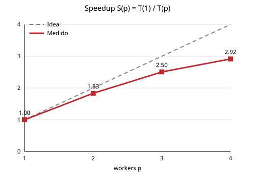

# Observaciones, taller semana 13 (colas de mensajes y master-worker)

Equipo castro-osorio
Integrantes presentes Felipe Castro, David Osorio
Fecha 27-11-2026

## Entorno

| Dato | Valor |
|---|---|
| CPU de Docker (Settings, Resources) | 12 (`docker info` → `NCPU=12`) |
| Memoria de Docker | 3,5 GiB |
| Procesador del notebook | AMD Ryzen 5 5500U, 6 núcleos físicos y 12 hilos |
| Sistema operativo | Windows 11 Home, Docker Desktop 29.1.3 (WSL2) |
| Broker | RabbitMQ 4.4.1, nodo `rabbit@rabbitmq` |

Las horas de los logs están en UTC (hora del contenedor), por eso aparecen 3 horas adelante.

## Paso 1, broker en el compose

```
$ docker compose config -q            (sin errores)
$ docker compose up -d rabbitmq
$ docker compose ps
sd_rabbitmq  Up 48 seconds (healthy)

$ curl -u guest:guest http://localhost:15672/api/overview
consola OK 4.4.1 rabbit@rabbitmq
```

El servicio `rabbitmq` usa la imagen `rabbitmq:4-management`, publica solo el puerto
15672 (consola web) hacia el host. El 5672 (AMQP) queda dentro de `sd_net`, que es por
donde hablan publicador, procesador, master y worker. Tiene `healthcheck` con
`rabbitmq-diagnostics ping`, y los demás servicios esperan con
`condition: service_healthy`, así no parten antes que el broker.

## Paso 2, el dominio viaja por una cola

Operaciones válidas del procesador (las del servicio de juegos de `dominio.py`)

```python
OPERACIONES_VALIDAS = {"TABLA", "UNIR", "ANOTAR"}
```

```
$ docker compose run --rm publicador ANOTAR david 5
[16:56:55] [729071] publicado id=1 ANOTAR david 5

$ docker compose logs procesador
[16:56:48] [e85582] esperando en 'operaciones', prefetch=1, ack manual
[16:56:55] [e85582] recibido id=1 op=ANOTAR
[16:56:55] [e85582] procesando id=1 ...
[16:56:58] [e85582] terminado id=1 -> ANOTAR david 5 procesada
```

Mensaje venenoso, una operación que no está en la lista

```
$ docker compose run --rm publicador BORRAR david
[16:57:11] [e85582] recibido id=1 op=BORRAR
[16:57:11] [e85582] descartado id=1, operación desconocida BORRAR
```

Se descarta con `basic_reject(requeue=False)`. Si se devolviera a la cola, la siguiente
réplica fallaría igual y el mensaje daría vueltas para siempre.

### Falla provocada con el consumidor apagado

```
$ docker compose stop procesador
$ docker compose run --rm publicador --n 20 ANOTAR david 1
[16:57:17] [dca705] 20 publicados en 'operaciones'
cola operaciones durable=True ready=20 unacked=0          (consola, antes del restart)

$ docker compose restart rabbitmq
rabbitmq healthy
cola operaciones durable=True ready=20 unacked=0          (consola, después del restart)

$ docker compose start procesador
[16:57:44] [e85582] recibido id=1 op=ANOTAR
...
[16:58:44] [e85582] terminado id=20 -> ANOTAR david 1 procesada
terminados tras reinicio: 20
```

| Publicados | En la cola después del restart | Procesados |
|---|---|---|
| 20 | 20 | 20 |

Las dos condiciones que evitaron la pérdida

1. **Cola durable** (`queue_declare(..., durable=True)` en `cola.py`). La definición de la
   cola se guarda en disco y vuelve después del reinicio del broker.
2. **Mensajes persistentes** (`delivery_mode=2` en `publicar()`). Cada mensaje se escribe
   en disco. Con una cola durable pero mensajes transientes la cola habría vuelto vacía.

Lo que no hizo falta es que el procesador estuviera vivo. El publicador terminó sin
esperar a nadie (desacoplamiento en el tiempo), y no sabe cuántos procesadores hay ni
dónde están, solo conoce el nombre de la cola (desacoplamiento en el espacio).

## Paso 3, tres réplicas y reentrega

```
$ docker compose up -d --scale procesador=3 procesador
$ docker compose run --rm publicador --n 12 ANOTAR david 1
$ docker kill semana13-procesador-2        (16:59:12, a los 2 s de publicar)

procesador-2  | [16:59:10] [428165] recibido id=3 op=ANOTAR
procesador-2  | [16:59:10] [428165] procesando id=3 ...
                 ... docker kill ...
procesador-3  | [16:59:13] [106d29] recibido id=3 op=ANOTAR (REENTREGADO)
procesador-3  | [16:59:13] [106d29] procesando id=3 ...
procesador-3  | [16:59:16] [106d29] terminado id=3 -> ANOTAR david 1 procesada
```

| Id reentregado | Réplica que murió | Réplica que lo terminó | Terminados de 12 |
|---|---|---|---|
| 3 | `428165` (`semana13-procesador-2`) | `106d29` (`semana13-procesador-3`) | 12 |

La réplica `428165` recibió el id=3 pero murió antes del `basic_ack`. El broker vio que se
cerró la conexión con un mensaje sin confirmar y lo devolvió a la cola con la marca
`redelivered`, por eso el log dice `(REENTREGADO)`. Con `prefetch=1` cada réplica tenía a lo
más un mensaje sin confirmar, así que solo hubo que reentregar uno.

### ¿Y si confirmamos al recibir? (`AUTO_ACK=1`)

```
$ docker compose up -d --scale procesador=3 procesador
[16:59:45] [9aca10] esperando en 'operaciones', auto_ack (sin prefetch)
$ docker compose run --rm publicador --n 12 ANOTAR david 1
$ docker kill semana13-procesador-1        (16:59:54)

procesador-1  | [16:59:52] [9aca10] recibido id=3 op=ANOTAR
procesador-1  | [16:59:52] [9aca10] procesando id=3 ...
                 ... docker kill ...
terminados: 8
cola ready=0 unacked=0
```

| AUTO_ACK | Al matar una réplica | Terminados de 12 | Semántica |
|---|---|---|---|
| 0 | El mensaje en proceso se reentrega a otra réplica | 12 | at-least-once |
| 1 | Se pierden los mensajes que tenía la réplica | 8 (se perdieron 4, los id 3, 6, 9 y 12) | at-most-once |

¿Por qué se pierden varios y no uno? Con `auto_ack` el broker borra cada mensaje apenas lo
envía y el `prefetch` no aplica, así que reparte los 12 de una vez en round-robin, 4 a cada
réplica. La réplica muerta tenía 4 en memoria (uno procesando y tres esperando) y para el
broker ya estaban entregados. La cola quedó en 0 y ningún log mostró error, la pérdida es
silenciosa.

Al terminar se dejó `AUTO_ACK=0` en el `.env`.

Ojo con at-least-once, el id=3 empezó a procesarse dos veces. Si `428165` hubiera alcanzado a
aplicar el `ANOTAR` antes de morir, `david` habría sumado 2 puntos en vez de 1. Para que la
reentrega no duplique efectos hace falta idempotencia (recordar los id ya aplicados), como
el `id_solicitud` de la semana 11.

## Paso 4, master-worker con 1, 2, 3 y 4 workers

Se hicieron dos pasadas completas de 1 a 4 workers. Las 8 corridas dieron `ok=True`.
Salida de la primera pasada (la segunda está en el CSV)

```
workers=1
worker      trozos   seg ocupado
796af8          40         14.38
workers=1  tiempo total=14.45s
primos=348,513  esperado=348,513  ok=True

workers=2
7655ee          20          8.04
796af8          20          7.76
workers=2  tiempo total=8.08s

workers=3
7655ee          14          5.77
796af8          13          5.38
ba7268          13          5.59
workers=3  tiempo total=5.79s

workers=4
32e4ca          10          5.15
7655ee          10          4.82
796af8          10          4.83
ba7268          10          4.95
workers=4  tiempo total=5.17s
```

`mediciones/mediciones.csv`

```
fecha,workers,n,trozos,segundos,primos,ok
2026-11-27 17:00:50,1,5000000,40,14.45,348513,True
2026-11-27 17:01:07,2,5000000,40,8.083,348513,True
2026-11-27 17:01:21,3,5000000,40,5.794,348513,True
2026-11-27 17:01:35,4,5000000,40,5.17,348513,True
2026-11-27 17:01:59,1,5000000,40,14.695,348513,True
2026-11-27 17:02:15,2,5000000,40,7.805,348513,True
2026-11-27 17:02:29,3,5000000,40,5.845,348513,True
2026-11-27 17:02:42,4,5000000,40,4.827,348513,True
```

El reparto quedó parejo gracias a `prefetch_count=1`. Con 3 workers 40 trozos no se dividen
exacto (14, 13, 13), pero el tiempo ocupado de cada uno quedó dentro de 0,4 s del resto.

## Paso 5, gráfico de speedup

```
$ docker compose run --rm graficar
  p  corridas   T(p) s   S(p)   E(p)  Karp-Flatt
  1         2    14.57   1.00   1.00           -
  2         2     7.94   1.83   0.92       0.090
  3         2     5.82   2.50   0.83       0.099
  4         2     5.00   2.92   0.73       0.124
gráfico escrito en mediciones/speedup.svg
```



¿Dónde se aplana la curva?

No se aplana de golpe. Docker tiene 12 CPU, así que con 4 workers todavía sobran núcleos y
no aparece el codo del ejemplo de 2 núcleos de la guía. La curva se va separando de la ideal
de a poco: 1,83 con 2, 2,50 con 3 y 2,92 con 4 (eficiencia de 0,92 a 0,73).

Lo que más explica la diferencia es que **cada worker trabaja más lento cuando hay más
workers**. Sumando la columna "seg ocupado" (CPU total que gastaron todos los workers):

| p | Suma de seg ocupado (promedio de las 2 pasadas) | Respecto de p=1 |
|---|---|---|
| 1 | 14,50 s | 1,00 |
| 2 | 15,55 s | 1,07 |
| 3 | 16,83 s | 1,16 |
| 4 | 19,06 s | 1,31 |

El trabajo es exactamente el mismo (los mismos 40 trozos), pero con 4 workers cuesta 31 % más
CPU. El notebook baja la frecuencia del procesador (turbo) cuando hay más núcleos ocupados y
todo corre dentro de la máquina virtual de WSL2 compartida con Windows. Un contenedor no es
un computador nuevo.

La parte serial, en cambio, es chica. La diferencia entre el tiempo total y el worker más
ocupado (lo que el master tarda en publicar y juntar) fue de 0,02 a 0,07 s. Karp-Flatt sube de
0,090 a 0,124 en vez de mantenerse constante, señal de que no es solo una fracción serial fija
(Amdahl), es un costo que crece con p.

Preguntas para el análisis autónomo (respondidas con experimentos en `analisis_speedup.md`)

- ¿Con cuántos workers se aplana de verdad? Probar 6, 8 y 12 workers para ver el efecto de
  los 6 núcleos físicos frente a los 12 hilos.
- ¿Cuánto pesa la comunicación? Repetir con `--trozos 400` (trozos más chicos, más mensajes)
  y con `--trozos 4` (pocos trozos, más desbalance).
- ¿Cambia la curva si se limitan las CPU de Docker a 2 en Settings, Resources?
